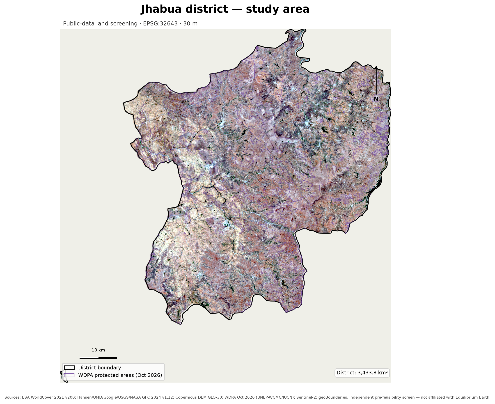
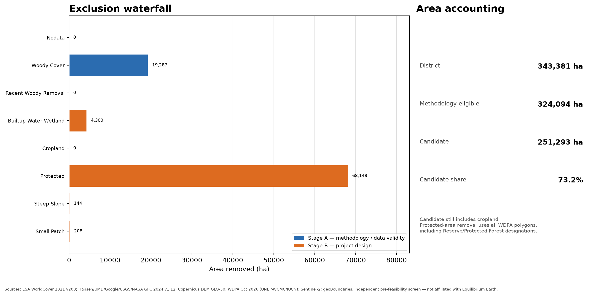
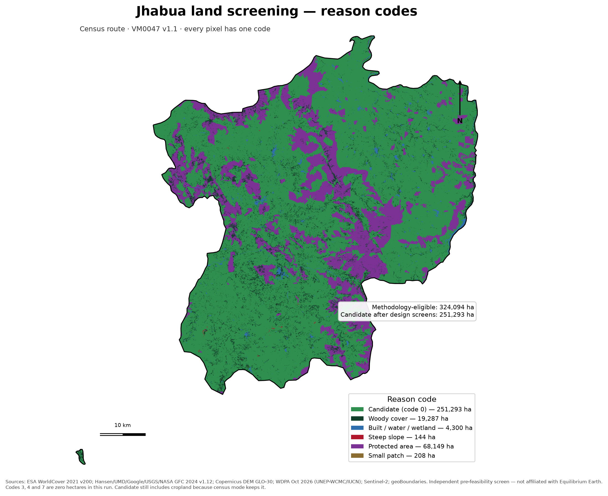
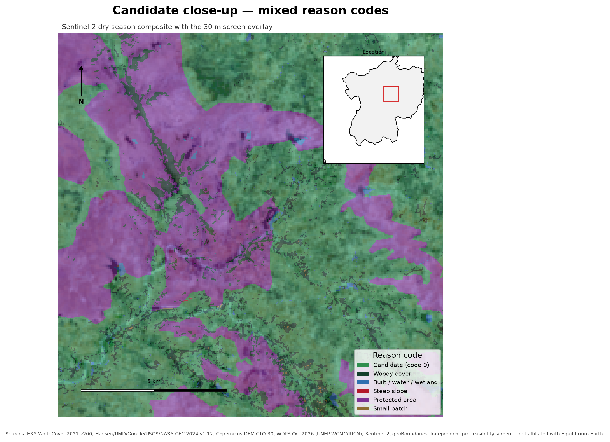
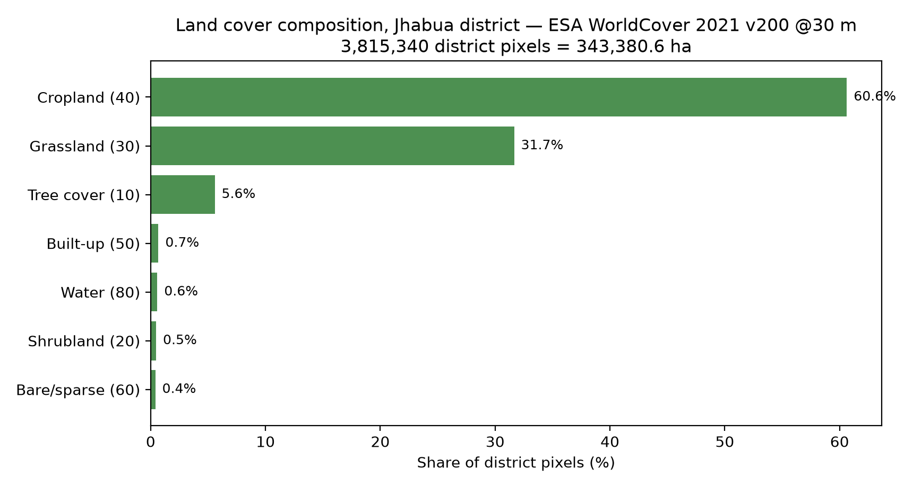
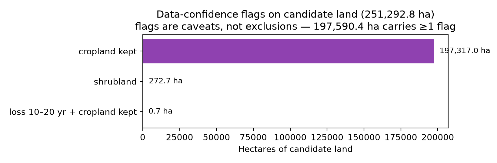

# REPORT — Land screening for agroforestry (ARR) candidacy, Jhabua district
*Independent pre-feasibility screening of candidate land using only public data.*

> **Framing — read before any hectare.** This is an **independent personal project** in
> GIS analysis. It documents a screening methodology; it references the VM0047
> methodology (Agriculture, Forestry and Other Land Use — "ARR", Verra VCS vVM0047
> v1.1) as a **rubric**, not a certified affiliation, a registration, or a plan to
> execute a project. **Nothing here is an eligibility determination, a baseline
> assessment, or a carbon-credit forecast.** The figures below characterise a
> *screening pool*, not a project boundary.

---

## 1. Executive summary

| Question | Result |
|---|---:|
| What is the screening surface? | Jhabua district, Madhya Pradesh, India — **3,433.78 km² / 343,380.6 ha** |
| At what resolution / CRS? | **30 m**, EPSG:32643, one shared grid (2,933 × 3,130 px), 1 px = 0.09 ha |
| Stage A (methodology validity) | **324,094.0 ha** (94.4%) methodologically eligible |
| Stage B (design screens) | **251,292.8 ha** candidate (73.2% of district) |
| Candidate carrying ≥1 **confidence flag** | **197,590.4 ha** (57.6% of district) |
| Largest exclusion | Protected areas (WDPA), **68,149.1 ha** |
| QA state | 19/19 checks passed, 0 blocking, 0 warnings; raster ⇄ vector area gap **+0.001%** |
| Test suite | **17/17 passing** |
| Reproduction | Notebook lab reproduces `reason_codes.tif` and `confidence_flags.tif` **byte-for-byte** |

**The honest reading of the headline (73.2%):** candidate land is a *targeting pool for
fieldwork to be conducted later*, not a final project area. That number is high because
two deliberate, documented design choices dominate — (1) **the census route keeps cropland**
(§4.3(8)(b)/§6.2(2)), which is 60.6% of the district, and (2) the **WDPA screen is
conservative** (any polygon excludes, including Reserve/Protected Forest designations,
not only IUCN I–IV). Neither is a bug; both are stated in config + docs.

---

## 2. Study area and data

**Jhabua district, Madhya Pradesh** sits at 74.16–75.01 °E, 22.39–23.24 °N, with a
small detached ADM2 component at the southwest (kept in the mask, never silently
dissolved). The working grid is EPSG:32643 at 30 m — recalculated against the
meters-based geoBoundaries ADM2 boundary layer, not against square-degrees nonsense.

**The 30 m contract.** Hansen and Copernicus DEM are natively 30 m. Sentinel-2 and
WorldCover (10 m) are **aggregated down**, never up: land cover classes use majority
voting; Sentinel-2 indices use per-band mean with explicit NaN handling. That means
the whole district is **3,815,340 pixels**, each exactly 0.09 ha, on one shared
transform/CRS — the single most important constraint enabling every later analysis.

| Layer | Source & version | Native | Role in screening |
|---|---|---|---|
| Land cover | **ESA WorldCover 2021 v200** | 10 m → 30 m majority | block built-up/water/wetland; woody-class proxy |
| Tree cover / loss / gain | **Hansen GFC 2024 v1.12** | 30 m → 30 m nearest | pre-existing woody biomass ≥10%; recent removal ≤10 yr |
| Elevation | **Copernicus GLO-30 DEM** (4 tiles) | 30 m | Horn slope >20° |
| Protected areas | **WDPA+WDOECM Oct-2026 (India)** | vector, 188 polys intersecting | blanket protection screen |
| Boundary | **geoBoundaries 2.0.1 India ADM2** | vector | the district mask & area reference |
| Imagery (backdrop only) | **Sentinel-2 2024 dry + monsoon composites** | 10 m → 30 m average | rendering, optional scoring |

Full provenance (URL, tile, version, SHA256, acquisition date) lives in `data/manifest.json`.


*Figure 1 — Study area: Jhabua district polygon overlaid on raw Sentinel-2 2024 dry-season composite; candidate-screening surface in context.*

---

## 3. Method

### 3.1 Pipeline

1. **Ingest.** Six public sources are clipped, mosaic-ed and reprojected onto the shared
   30 m grid in EPSG:32643. A missing file **stops the pipeline** with a hard error; it
   never zero-fills a gap.
2. **QA gate.** 19 **measured** checks: each aligned GeoTIFF is opened and checked for
   identity (shape, dtype, CRS, nodata), coverage, plausibility (e.g., Hansen loss year ≤
   2024, so the config is version-aware) and **area reconciliation** — the raster district
   area must agree with the vector ADM2 area within tolerance. `blockers` fail the run.
3. **Two-stage exclusion waterfall** with **one reason code per pixel** (first failing
   rule in stage order wins; that pixel's code is final). Stage A is *methodology*, Stage
   B is *design screening* — deliberately not merged so the two audiences
   (methodology-eligibility vs project-feasibility) each get their own honest number.
4. **Small patches** re-code to **`8`** (transaction-cost screen) on what is still
   eligible after both stages.

### 3.2 Reason-code contract (canonical, fixed)

| code | meaning | treated as |
|---:|---|---|
| 0 | **Candidate (code 0)** | the output (never "eligible"); not Stage-A "eligible" |
| 1 | Pre-existing woody biomass | Stage A — methodology (§4.3(8)(a)/§6.2(1)) |
| 2 | Built-up / water / wetland | Stage B — design |
| 3 | Cropland excluded | Stage B — **off in census mode (kept 0 ha)** |
| 4 | Recent woody removal (≤10 yr) | Stage A — census-route exclusion (§4.4.2(1)) |
| 5 | Slope > 20° | Stage B — design |
| 6 | Protected area | Stage B — WDPA, any polygon |
| 7 | Nodata inside district | Stage A — data validity |
| 8 | Small patch (< 1.0 ha) | Stage B — transaction cost (removed after Stages A+B) |
| 255 | Outside the boundary | excluded from all areas |

**Attribution rule.** For overlapping conditions, each pixel is claimed by the **first
failing** screen in stage order, so raw filter areas are supersets, not addends. This
makes the pipeline auditable pixel-by-pixel; it also means "protected ha removed"
cannot be compared to any independent raw-mask number without re-attributing.

### 3.3 Data-confidence flags (a separate layer, not exclusions)

`shrubland`, `loss 10–20 yr ago`, and `cropland kept` are **flags** on candidate pixels
that mark *uncertainty about the proxy*, not *exclusions* and not *penalties*.

---

## 4. Results

### 4.1 Waterfall

| Step (in order) | Removed (ha) | Remaining (ha) | % of district |
|---|---:|---:|---:|
| District (geoBoundaries ADM2 @30 m) | — | 343,380.6 | 100% |
| NODATA (data validity, Stage A) | 0.0 | 343,380.6 | 0% |
| Pre-existing woody ≥10% (Stage A) | 19,286.6 | 324,094.0 | 94.4% |
| Recent woody removal ≤10 yr (Stage A) | 0.0 | 324,094.0 | 94.4% |
| Built-up / water / wetland (Stage B) | 4,300.2 | 319,793.8 | 93.1% |
| Cropland exclusion (Stage B) — **off** | 0.0 | 319,793.8 | 93.1% |
| Protected areas (WDPA, any polygon) | 68,149.1 | 251,644.7 | 73.3% |
| Slope > 20° | 144.2 | 251,500.5 | 73.2% |
| Small patches < 1 ha | 207.7 | **251,292.8** | **73.2% (candidate)** |

**Two measured zeros, not gaps.** The recent-removal screen removes exactly 0 ha because
only **12** aligned 30 m pixels inside the district carry any Hansen loss at all
(latest loss year **2010**, i.e., far older than the 10-year window). The
recent-removal exclusion (§4.4.2(1)) is therefore *not applicable here* on the evidence
we have — a fact of the data, not missing data. Hansen covers 2000–2024, so 2025–2026
removals are structurally invisible; that limitation is stated in `docs/limitations.md`.


*Figure 2 — Stage-A/Stage-B waterfall, same numbers as the table above; rendered directly by the pipeline from `waterfall.csv`.*

### 4.2 Reason codes (the pixel-level audit trail)

| code | pixels | ha | % of district |
|---|---:|---:|---:|
| 0 Candidate | 2,792,142 | 251,292.8 | 73.2% |
| 1 Woody | 214,296 | 19,286.6 | 5.6% |
| 2 Built-up/water/wetland | 47,780 | 4,300.2 | 1.3% |
| 5 Steep | 1,602 | 144.2 | 0.04% |
| 6 Protected | 757,212 | 68,149.1 | 19.8% |
| 8 Small patch | 2,308 | 207.7 | 0.06% |
| — Σ (codes 3, 4, 7 absent) | **3,815,340** | **343,380.6** | 100% |

Every single excluded pixel carries exactly one documented reason; codes 3, 4 and 7
are **absent** because the corresponding screens removed 0 ha — an outcome of the
data and config, verified by independent reconciliation.


*Figure 3 — Per-pixel reason codes. Dark green = Candidate (code 0). Purple = protected; brown-grey = built-up/water; tan = steep; light green = shrubland-flagged candidates.*


*Figure 4 — Zoomed view of candidate land (dark green) with the district boundary; Sentinel-2 2024 dry composite as backdrop.*

---

## 5. Analysis

### 5.1 Why the candidate is 73.2% — land-cover context


*Figure 5 — WorldCover class distribution inside the district (3,815,340 px).*

Cropland is **60.6%** of the district and **grassland 31.7%** — together ~92% of the
district. Under VM0047's census route (§4.3(8)(b)/§6.2(2)), continuous cropping is
**inside** the methodology, not outside it; the design decision `exclude_cropland:
false` therefore keeps cropland in the candidate pool, driving the 73.2% headline.
Tree cover registers at only 5.6% — and, more importantly, Hansen's ≥10% tree canopy
occupies just **2,441 px (~219.7 ha)** *inside the district*, which is why the woody
screen trims only 19,286.6 ha (5.6%) rather than more.

That is the fastest way to understand this run in one sentence: **Jhabua is a
cropland-and-grassland district — a theatre where ARR candidacy lives by keeping
ambiguous, low-competition land in the pool and by flagging wherever the proxies
cannot vouch for the exclusion they claim.**

### 5.2 The WDPA screen — conservatism by design

Bounding-box query over India returned **1,376 WDPA+WDOECM polygons**, of which **188**
intersect Jhabua. The config excludes **any of them** (including Reserve Forest and
Protected Forest designations, not just IUCN I–IV). This is a **conservative design
choice**, deliberately trading usable area for defensibility: an IUCN I–IV-only
sensitivity would legally re-open a large part of the 68,149.1 ha coded **6**. The
over-conservatism is *acknowledged*, not hidden — see `docs/limitations.md` — and a
one-line config sensitivity (`wdpa_mode`) is on the follow-up list, not implemented
here.

### 5.3 Raw filters vs waterfall attribution — why the numbers do not add to "68,149 + 144 + …"

| Rule | Raw mask inside district (ha) | Attributed by waterfall (ha) | Difference (ha) |
|---|---:|---:|---:|
| BUILTUP_WATER_WETLAND | 4,308.2 | 4,300.2 | +8.0 |
| PROTECTED | 73,144.5 | 68,149.1 | +4,995.4 |
| STEEP_SLOPE | 905.5 | 144.2 | +761.3 |
| WOODY | 19,286.6 | 19,286.6 | 0.0 |

Because Stage-B raw masks **overlap**, the first-fails-wins rule credits each pixel to
the earliest screen in `stage_a_order + stage_b_order` that rejects it. Steep pixels
are (correctly) claimed 905.49 ha by *slope* ≤ raw, but the waterfall only attributes
144.18 ha to slope because the rest were already claimed by *protected* or another
rule earlier in stage order. **This is not an arithmetic error; it is the attribute of
a decision-compatible audit trail**, and the notebook lab reproduces this exactly
(byte-for-byte identity with `reason_codes.tif`).

### 5.4 Fragmentation — what "83% of the workable area is one patch" means

On the *pre-removal* candidate surface (after Stages A+B, before code 8), there were
**1,051** patches; after removing patches < **1.0 ha** (connectivity 8), **169**
survive, losing 207.7 ha (0.06% of district). Crucially:

- **1 patch holds 244,416.0 ha** — 97.3% of the entire candidate is one contiguous
  component covering the district's cropland heartland.
- The **median** of the 169 patches is only **3.33 ha** — a long tail of small pockets.

The practical implication: the candidate is **not confetti**. It is one big field
(of which cropland is the habitat), so transaction cost in this screening pool will
be **community-aggregation-led** rather than patch-detection-led. That's a community
engagement fact, not a GIS fact, but the GIS work is what reveals it.

### 5.5 Confidence flags — what the pipeline flags rather than excludes


*Figure 6 — Flag composition on the candidate surface. Flags mark uncertainty, not exclusion; several can co-occur.*

| Flag set (candidate land only) | ha | % of candidate |
|---|---:|---:|
| `cropland kept` | 197,317.0 | 78.5% |
| `shrubland` | 272.7 | 0.11% |
| `loss 10–20 yr ago` (with cropland kept) | 0.7 | < 0.01% |
| **≥1 flag** | **197,590.4** | **78.6%** |

197,317.0 ha of the candidate is flagged **because the census route deliberately keeps
cropland** — a *design* caveat (the cropland mask is not validated), not an
exclusion. Shrubland (272.7 ha) is flagged because woody *biomass* can register at a
canopy-cover proxy even when thicket biomass exceeds the threshold. Only **53.5 ha**
of candidate (excluding the flag) is un-flagged free cropland-and-grassland. The
rest of the candidate (251,292.8 − 197,590.4 = 53,702.4 ha) carries no flag — mostly
grassland with a clear Hansen canopy proxy. That is a **clean pool**, but not a
*project-ready* pool — tenure, community, and safeguards live outside the screen.

---

## 6. Data quality and verification

- **QA gate: 19/19 checks pass, 0 blocking, 0 warnings.** Area reconciliation between
  raster and boundary: **raster 343,380.6 ha vs reference 3,433.78 km² → gap +0.001%**.
- **Test suite: 17/17 passing** (`python -m pytest -q`).
- **Hands-on reproduction:** `notebooks/learn_by_hand.ipynb` re-implements the entire
  screen from scratch — grid contract, pixel area, woody rules, stage order, patch
  pass, flags — and asserts **byte-for-byte equality** with `reason_codes.tif` and
  `confidence_flags.tif` (8/8 capstone asserts pass).
- **Three production bugs found and fixed during the build**, each now guarded:
  1. **Wrong Hansen tile band** (`20N_070E` covers 20°N–10°N — the first download was
     wrong; Jhabua is at 22.4–23.2°N and needs `30N_070E`). Fixed by coordinate-band
     checking before ingest.
  2. ** silent NaN propagation** in Sentinel-2 reads (`src_nodata=np.nan`; NaN is not
     data).
  3. **Matplotlib `imshow` extent order** is `(left, right, bottom, top)`; the
     naive `(left, bottom, right, top)` renders a *visually plausible, silently
     wrong* map — a real, common, and worth-writing-down bug.

---

## 7. Limitations — state these before quoting a hectare

- **30 m grid.** ±0.09 ha per-pixel quantization; for targeting and triage, not for
  registration, boundaries or measurement.
- **Proxies, not biomass.** Tree canopy (Hansen) + WorldCover classes are proxies for
  "pre-existing woody biomass". Shrubs and thickets can exceed 10% woody biomass
  without triggering either.
- **Hansen ends 2024**; the 2025–2026 window is invisible. The recent-removal zero
  above is a measured zero, not an absence of evidence for 2025–2026.
- **WDPA over-exclude.** Any-polygon designation screen is intentionally conservative;
  IUCN-only sensitivity pending.
- **No tenure/FPIC/PESA–FRA/safeguard/baseline/additionality/leakage/fieldwork.**
  This screen concerns itself with *spatial eligibility surrogates only*.
- **The district boundary is ADM2-derived** and includes the detached southwestern
  fragment; a registry-grade boundary would be needed for any official use.

---

## 8. Reproduce

```bash
python -m pip install -r requirements.txt
python src/ingest.py config/jhabua.yaml        # builds the aligned 30 m stack
python src/qaqc.py --check config/jhabua.yaml  # 19 measured checks; hard-fails on error
python src/screening.py config/jhabua.yaml     # waterfall + reason_codes + flags
python scripts/make_maps.py config/jhabua.yaml # the 4 portfolio maps
python -m pytest -q                            # 17 tests
```

Configure everything in `config/jhabua.yaml` — thresholds, stage orders, classes,
cropland/patch/slope screens — there is **no magic number** in the pipeline code.
Raw source provenance (URL, tile, version, SHA256, acquisition date) lives in
`data/manifest.json` and is never redistributed.

---

## 9. References

- Verra **vVM0047 v1.1** (ARR, 2025-05-14) — methodological rubric only. PDF in repo with SHA256.
- Hansen M.C. et al. **Global Forest Change 2024 v1.12** (30 m, 2000–2024).
- ESA **WorldCover 2021 v200** at 10 m.
- ESA **Copernicus GLO-30 DEM**.
- **Protected Planet WDPA + WDOECM Oct-2026** (India) — disposition: attribution + no-redistribution.
- **geoBoundaries ADM2** (India, 2.0.1).
- ESA **Sentinel-2** L2A composites (2024 dry + monsoon median).
- Software documentation: `rasterio`, `geopandas`, `numpy`, `scipy.ndimage`, `matplotlib`.

Details: `docs/methodology.md` (method interpretation), `docs/limitations.md`
(what can't be claimed), `docs/case_study.md` (portfolio narrative + CV bullets),
`learning.md` (the 12-module GIS training manual), `notebooks/learn_by_hand.ipynb`
(the byte-exact reproduction lab).
